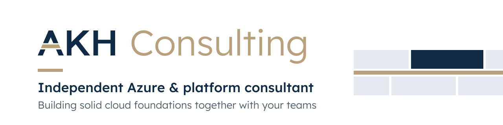

<picture>
  <source media="(prefers-color-scheme: dark)" srcset="AKH-GitHub-banner-moerk-1280x320.svg">
  
</picture>

I'm Andreas Hvid, an independent Azure and platform consultant based in Copenhagen.
I work together with your own teams to build solid cloud foundations: landing zones,
governance and automation that your developers can build on and your team can run
after I leave.

### What I work with

- Azure landing zones and subscription vending
- Azure Policy and governance as code
- Terraform and GitHub Actions pipelines
- Platform engineering and developer self-service
- Identity and security baselines in Entra ID

### How I work

- Alongside your teams, not instead of them
- Everything as code, reviewed in pull requests
- Documentation and handover, so your team owns the result

### Get in touch

[LinkedIn](https://www.linkedin.com/company/akhconsulting)
